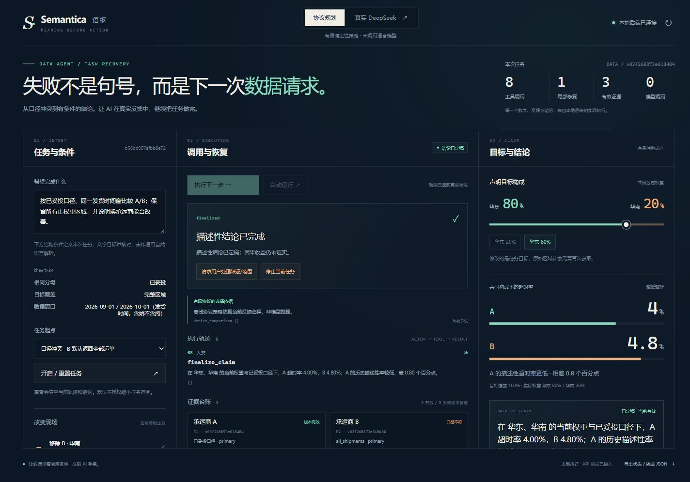

# 语枢 Semantica · 任务恢复工作台

**从口径冲突到有条件的结论，让 AI 继续把任务做完。**

赛题二 A「AI 使用的大数据平台」

语枢为现有数据仓库增加面向 Agent 的能力接口。每次请求都有明确口径，每份结果都有执行证据；发生冲突或缺证时，平台给出可以继续工作的反馈，由 AI 选择下一项合法工具。

## 作品解决什么问题

“比较两家承运商的超时率”看似简单，却隐含了分母、时间、区域构成与覆盖范围。即使每条 SQL 都正确，两份结果也可能无法直接比较。

工作台将这些条件贯穿任务全过程。它检查请求和证据是否匹配，展示尚未满足的要求，支持补证与重新计算，并在条件变化后撤销旧结论。

## 三个值得亲手体验的场景

| 场景 | 屏幕上会发生什么 | 可以理解什么 |
|---|---|---|
| 产品分母不同 | 定位字段冲突，AI 选择同口径取证，服务端完成比较 | 查询成功之后仍需要任务条件检查 |
| 改变目标构成 | 华东权重从20%改80%，计数复用，较低超时率从B转为A | 用户条件会改变结论，而不必重复取数 |
| 华南证据缺失 | 有合法备用视图时补取；无权限时请求用户处理 | 缺证不能填零，AI不能擅自缩小范围 |

示例中的区域率为 A：华东2%、华南12%；B：华东4%、华南8%。采用共同的20%/80%权重，A=10%、B=7.2%；采用80%/20%，A=4%、B=4.8%。全部为合成数据。



## 数据怎样交给 AI

```text
用户声明目标条件
    ↓
平台检查口径与覆盖，返回冲突或缺口
    ↓
AI选择下一项工具 → 查询引擎执行 → 生成证据
    ↓
服务端重新检查条件、计算并构造结论
```

模型负责提出下一步，计算与授权检查由服务端完成。模型不能提交任意 SQL、自编数值或替用户授权改变范围。工作台提供确定性的协议演示与真实模型模式，并清楚标明当前模式。

本体与指标目录提供共同业务语言；任务反馈负责指导下一步数据使用；已有数仓继续存储和查询。Agent 也可以通过 MCP 发现任务状态与执行工具。

## 观看顺序

1. 阅读 [思想进步与路演导读](参赛材料/06-思想进步与路演导读.md)，理解任务恢复的核心想法。
2. 打开工作台，从“口径冲突”开始，推进到比较与定稿。
3. 改变区域权重，再执行下一步，观察计数复用与排名变化。
4. 切换“数据缺片”，观察补证与无权限时的处理。

完整讲稿、按钮顺序、现场节奏和答辩问题均收录在导读中。

## 本地运行

需要 Python 3.11 或以上。在本目录运行：

```powershell
python -m venv .venv
.\.venv\Scripts\python.exe -m pip install -r requirements-lock.txt
.\.venv\Scripts\python.exe scripts/run_workbench.py
```

访问 [http://127.0.0.1:8766](http://127.0.0.1:8766)。协议演示无需语言模型服务。真实模型模式依赖本机模型桥接；工作台提供保存的真实执行记录供核对，配置与展示方式见导读。

若希望进一步体验底层语义查询、契约预览及证据重放，在同一环境运行：

```powershell
.\.venv\Scripts\python.exe data/generate_data.py
.\.venv\Scripts\python.exe -m streamlit run app.py
```

## 深入阅读

- [从 main 到两版优化的思想演进](参赛材料/08-main与两版优化的思路演进.md)
- [思想进步与路演导读](参赛材料/06-思想进步与路演导读.md)
- [技术与证据底座](参赛材料/02-技术与证据.md)
- [任务恢复机制与实际模型记录](参赛材料/05-任务恢复工作台.md)

## 当前范围

原型使用合成物流数据，任务条件由结构控件明确声明。备用视图来自同一仓库；数据变化采用整个快照的失效检查。当前能形成有证据的历史描述性比较，不能据此承诺更换承运商的因果收益。
